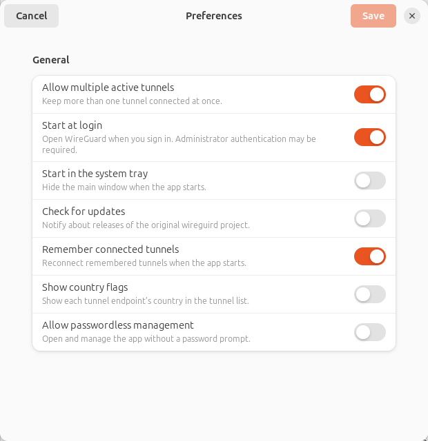
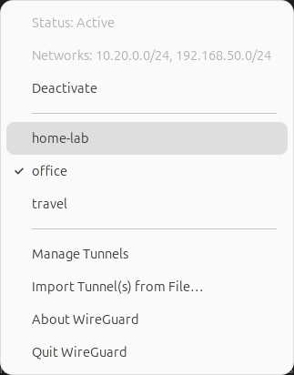
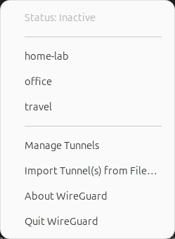

# wireguard-linux-gui

A native Linux desktop client for [WireGuard](https://www.wireguard.com/).
Import your VPN configuration, manage tunnels, and check connection activity
from a GTK4/Libadwaita window or the system tray.

Based on [wireguird](https://github.com/UnnoTed/wireguird), with a GTK4 interface
that follows the desktop's supported light/dark appearance and accent colors.
The baseline platform is Ubuntu 24.04 with GTK 4.14 and Libadwaita 1.5.


*The screenshots use example profiles and simulated connection activity.
No real VPN endpoint or private key is shown.*

[Installation](#installation) · [Usage](#usage) · [Preferences](#preferences) ·
[System tray](#system-tray) · [Troubleshooting](#troubleshooting) ·
[Contributing](#help-and-contributing)

## Features

- Manage configurations in `/etc/wireguard` using `wg-quick`.
- Create, edit, rename, import, export, and remove tunnel profiles.
- Import one or more `.conf` files or a `.zip` archive; export profiles to zip.
- Inspect interface status, public keys, addresses, DNS, peer endpoint,
  allowed IPs, latest handshake, and received/sent traffic.
- Keep several tunnels active, or switch to one active tunnel at a time.
- Activate and deactivate tunnels from the system tray.
- Optionally start at login, start in the tray, and reconnect remembered tunnels.
- Show endpoint country flags and retain settings from the original wireguird.

## Installation

### Requirements

| Component | Requirement |
| --- | --- |
| Operating system | Linux; Ubuntu 24.04 is the baseline |
| Interface libraries | GTK 4.14+ and Libadwaita 1.5+ |
| Tunnel tools | `wireguard-tools` (`wg` and `wg-quick`) |
| DNS integration | `resolvconf` for configurations that use `DNS` |
| Desktop integration | A graphical session, D-Bus, and PolicyKit/`pkexec` |
| System tray | A StatusNotifier host; Ubuntu includes one |
| Building from source | Go 1.24+, a C toolchain, and native development libraries |

You need a WireGuard configuration from your VPN provider or server
administrator. This app manages a WireGuard client; it does not supply a VPN
service or provision a remote server.

### Install `wg` and `wg-quick`

Both commands are included in the **`wireguard-tools`** package; there is no
separate `wg-quick` package to install on Ubuntu/Debian or Fedora.

On Ubuntu 24.04 / Debian:

```sh
sudo apt update
sudo apt install wireguard-tools
```

If your tunnel configuration contains a `DNS = ...` line, also install the DNS
helper used by `wg-quick`:

```sh
sudo apt install resolvconf
```

On Fedora:

```sh
sudo dnf install wireguard-tools
```

Check that both commands are available:

```sh
command -v wg wg-quick
wg --version
```

These checks do not activate a tunnel. Installing the tools is separate from
installing this GUI. See the [official WireGuard installation guide](https://www.wireguard.com/install/)
for other distributions and [Ubuntu's DNS guidance](https://ubuntu.com/server/docs/how-to/wireguard-vpn/common-tasks/)
for `wg-quick` DNS integration.

### Build from source

Follow [development setup and build instructions](CONTRIBUTING.md#development-setup)
for the native dependencies and build commands, then follow
[local installation](CONTRIBUTING.md#install-locally-for-desktop-testing) to add
the binary, desktop launcher, icons, and PolicyKit policy.

Launch **WireGuard** from Applications after installation. The launcher uses
`pkexec` to request administrator access for reading and managing
`/etc/wireguard` and running `wg-quick`.

### Packages

Local package builds produce Linux **amd64** `.deb`, `.rpm`, and `.tar.gz`
artifacts; see [packaging instructions](CONTRIBUTING.md#build-packages).
Use packages built from this checkout for this GTK4 client. Historical releases
and the app's update checker refer to the original **wireguird** repository;
they are not releases of this renamed project.

For removal, see [uninstallation instructions](CONTRIBUTING.md#remove-a-local-development-installation).

## Usage

### Import and connect

1. Launch **WireGuard** and accept the administrator authentication prompt.
2. Choose **+ → Import Tunnel(s) from File…** and select `.conf` or `.zip` files.
3. Select a tunnel in the sidebar to inspect its Interface and Peer cards.
4. Choose **Activate**. The status changes to **Active**, the sidebar gains a
   checkmark, and the button changes to **Deactivate**.
5. Check **Latest handshake** and **Transfer** for peer activity. Choose
   **Deactivate** when you want to disconnect.

Imports preserve existing profiles: a duplicate filename is rejected. Tunnel
names must contain 1–15 letters, numbers, or `_ = + . -` characters, without the
`.conf` extension; `.` and `..` are not valid names.

**Active** means the local WireGuard interface is up. A recent handshake and
changing transfer counters help confirm that the peer is responding. Status
refreshes about every second while the window is open and every five seconds
while hidden, including changes made through `wg-quick` or systemd. Reopening
the window or toggling a tunnel requests an immediate refresh.

### Create or edit a tunnel

Choose **+ → Add Empty Tunnel…** to generate a private key and start a profile.
Give it a name, fill in the configuration supplied by your administrator, and
choose **Save**. Select an existing tunnel and use **Edit**, below its details,
to change its name or configuration text.

For example, a split tunnel can route only the office networks through WireGuard:

```ini
[Interface]
PrivateKey = <your-client-private-key>
Address = 10.20.0.2/32
DNS = 10.20.0.1

[Peer]
PublicKey = <your-server-public-key>
AllowedIPs = 10.20.0.0/24, 192.168.50.0/24
Endpoint = 192.0.2.1:51820
PersistentKeepalive = 25
```

This is an illustration, not a working VPN configuration. Replace both key
placeholders and the documentation-only endpoint `192.0.2.1` with your own
values; addresses, DNS, and allowed networks must match your server setup.
Keep the generated private key secret and give your **public** key to the
server administrator.

### Export or remove profiles

Use the header menu **Export Tunnels to Zip…** to back up all `.conf` profiles.
Exported archives include private keys and any preshared keys; store them
securely and remove secrets before sharing configurations or logs.

Select a tunnel and choose **−** to remove its configuration after confirmation.
Removing a profile leaves an already active interface running. Deactivate the
tunnel before removing it if you also want to disconnect.

### Keyboard shortcuts

| Shortcut | Action |
| --- | --- |
| `Ctrl+O` | Import tunnels |
| `Ctrl+,` | Open Preferences |
| `F5` | Refresh the tunnel list |
| `Ctrl+Q` | Quit the app |
| `Esc` in the editor | Close, with confirmation if changes are unsaved |
| `Esc` in Preferences | Close, with a save/discard prompt if changes are unsaved |

## Preferences

Open **Preferences…** from the header menu or press `Ctrl+,`.



| Preference | Default on a fresh setup | Behavior |
| --- | --- | --- |
| Allow multiple active tunnels | On | Keep existing tunnels connected when activating another. With this off, activating a tunnel disconnects other active tunnels first. |
| Start at login | On when a desktop user is identified and no entry exists | Open the app when that desktop user signs in. Existing enabled or disabled entries are respected. |
| Start in the system tray | Off | Hide the main window at startup when a tray host is available. |
| Check for updates | Off | Check releases of the original wireguird project. |
| Remember connected tunnels | On | Reconnect remembered tunnels after the app starts. |
| Show country flags | Off | Look up the endpoint's country and show its flag in the sidebar. |
| Allow passwordless management | Off | Modify the installed app PolicyKit policy to allow management without an administrator password prompt. This affects the installed policy for all users. |

Choose **Save** to apply changes or **Cancel** to restore saved values. Closing
with unsaved changes offers **Keep Editing**, **Discard**, or **Save**. Country
flags preview immediately; canceling restores the saved flag preference.

### Login startup

**Start at login** applies to the desktop user who launched the app. Administrator
authentication may appear at login; canceling skips that launch. If no non-root
desktop user can be identified, the preference is unavailable.

**Start in the system tray** controls window visibility separately. Without a
tray host, the app shows its window. **Remember connected tunnels** controls
reconnection after the app starts; it does not enable a VPN service at system boot.

The login entry is `wireguard-linux-gui.desktop` under
`$XDG_CONFIG_HOME/autostart` (normally `~/.config/autostart`). Turning startup off
and saving writes `Hidden=true`. Desktop-menu launches preserve a custom
`XDG_CONFIG_HOME`; direct `sudo` launches use the invoking user's `~/.config`.

## System tray

The WireGuard dragon icon is dimmed when inactive and uses the panel's foreground
color when active, following the panel's light/dark theme.

| Active | Inactive |
| --- | --- |
| <br> | <br> |

The tray menu shows **Status**, tunnel checkmarks, **Manage Tunnels**, import,
About, and Quit. When active, it also shows **Networks** and **Deactivate**
(**Deactivate All** for several interfaces). Tunnel actions are disabled when
live status is unavailable.

Closing the window keeps the app in the tray when a StatusNotifier host is
available. Choose **Manage Tunnels** or launch the app again to reopen the
existing window. Without a host, closing the window exits the app.

**Quit WireGuard** exits the GUI and leaves active tunnels running. Deactivate
them first if you want to disconnect as well.

## Configuration and privacy

| Data | Location / handling |
| --- | --- |
| Tunnel profiles | `/etc/wireguard/*.conf`; profiles created or imported by the app are owner-readable/writable only (`0600`) |
| App preferences | `wireguard-linux-gui.settings` in the process's working directory |
| Legacy preferences | `wireguird.settings` in that directory is loaded if the new file is absent; subsequent saves use the new filename |
| Login startup | The desktop user's XDG autostart directory, described above |
| Country database | `countries.mmdb` in the working directory, downloaded when flags are enabled and the database is missing or older than a week |

Country lookup downloads the database from
[IPLocate's public database repository](https://github.com/iplocate/ip-address-databases)
and resolves hostname endpoints through your system resolver. IP-to-country
lookups then use the local database. Private or unrecognized endpoints may have
no flag. Enabling update checks contacts GitHub for original wireguird releases.

## Troubleshooting

| Symptom | What to check |
| --- | --- |
| No tunnels listed | Import a profile or check that `.conf` files exist in `/etc/wireguard`. Use `F5` to refresh. |
| Activation fails | Open **View Log** in the header menu. Check keys, endpoint, routing, `wg-quick`, and `resolvconf` when the profile uses DNS. |
| Active but no traffic | Check the latest handshake, transfer counters, server configuration, allowed IPs, and endpoint reachability. Interface status alone does not confirm a connection to the peer. |
| Status is unknown / controls disabled | Live WireGuard status could not be read. Check administrator access and logs, then refresh. |
| No tray icon | Check that the desktop provides a StatusNotifier host. The window remains accessible without one. |
| App opens at login unexpectedly | Turn off **Preferences → Start at login** and save. Starting in the tray is a separate setting. |
| Preferences will not save | Check write access to the working directory, the user's autostart directory, or the installed PolicyKit policy, depending on the changed option. |
| Build fails on GTK or introspection | Follow [native dependency troubleshooting](CONTRIBUTING.md#troubleshoot-missing-native-dependencies). |

## Help and contributing

Search this repository's issues before reporting a bug or requesting a feature.
Include the distribution, desktop environment, app version or commit,
reproduction steps, and relevant logs. Remove private keys, preshared keys, and
other secrets from attachments.

See [CONTRIBUTING.md](CONTRIBUTING.md) for development setup, tests, packaging,
and pull request guidance. Contributions to code, documentation, and the
interface are welcome.

## Credits and license

Based on [UnnoTed/wireguird](https://github.com/UnnoTed/wireguird).
WireGuard is developed by the [WireGuard project](https://www.wireguard.com/).

[MIT](LICENSE). See [third-party notices](THIRD_PARTY_NOTICES.md) for the
MPL-2.0 GTK4/Libadwaita bindings and their source links.
