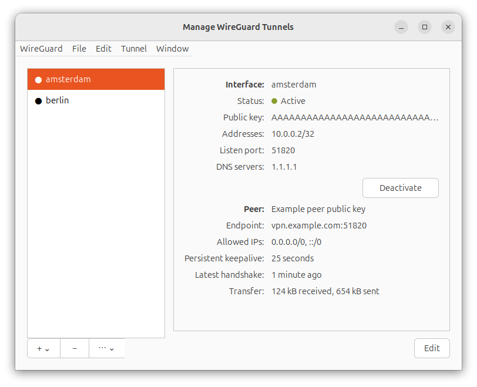

# wireguard-linux-gui

A Linux GTK client for [WireGuard](https://www.wireguard.com/), based on
[wireguird](https://github.com/UnnoTed/wireguird).

The interface uses native GTK 3 widgets and follows the active system GTK theme,
including its fonts, colors, and control styling. Its layout follows WireGuard
for macOS: a tunnel sidebar with a bottom action bar, one Interface and Peer
details panel, and a separate Log window.

- Lists tunnel configurations from `/etc/wireguard` and controls them with `wg-quick`.
- Imports `.conf` and `.zip` files and exports tunnels to zip.
- Includes a system tray menu, optional country flags, and remembered connections.
- Preserves settings from `wireguird.settings` when the new settings file is absent.
  Saving preferences writes `wireguard-linux-gui.settings`.

## Getting started

Use a Linux desktop with GTK 3, Ayatana AppIndicator, `wireguard-tools`, and
`resolvconf`. To build from a checkout, follow the
[build instructions](CONTRIBUTING.md#build-and-run).
To install a local build and test it from Applications, follow the
[desktop testing instructions](CONTRIBUTING.md#install-locally-for-desktop-testing).

Launch an installed copy from your desktop application menu. The launcher uses
`pkexec` to request root access, which is needed to read and manage tunnel
configurations in `/etc/wireguard`.

Use **+** to add an empty tunnel or import WireGuard `.conf` and `.zip` files.
Select a tunnel to inspect its Interface and Peer fields, then activate it.
Use **−** to remove it and **⋯** for View Log, export, and settings. The Edit
button sits below the details panel.

Closing the window keeps the app in the system tray. Launching it again or
choosing **Manage Tunnels** in the tray brings back the existing window. Choose **Quit WireGuard**
to exit the app; active tunnels continue running independently.

The tray icon, tunnel checkmarks, and profile status refresh from live WireGuard
interfaces every second while the window is open and every five seconds while
hidden. Reopening the window or activating/deactivating a tunnel refreshes
immediately. Status queries run in the background and include changes made with
`wg-quick` or systemd. The tray menu shows **Status**, active **Networks**, and **Deactivate**, followed
by tunnel checkmarks, management and import actions, About, and Quit. Networks
and Deactivate are hidden when inactive. Activation is disabled when status
is unavailable; tunnel controls are disabled when no profile is selected.
An active interface does not guarantee that a peer is reachable; check the
latest handshake and transfer counters for peer activity.

Local package builds produce `.deb`, `.rpm`, and `.tar.gz` files; see
[packaging instructions](CONTRIBUTING.md#build-packages).

Historical wireguird releases and the release check still point to the original
upstream repository. They are not releases of this renamed project.

## Help and contributing

Open an issue in this repository for bugs or feature requests. See
[CONTRIBUTING.md](CONTRIBUTING.md) for development setup, testing, build
troubleshooting, and guidance on issues and pull requests.

## License

[MIT](LICENSE).
